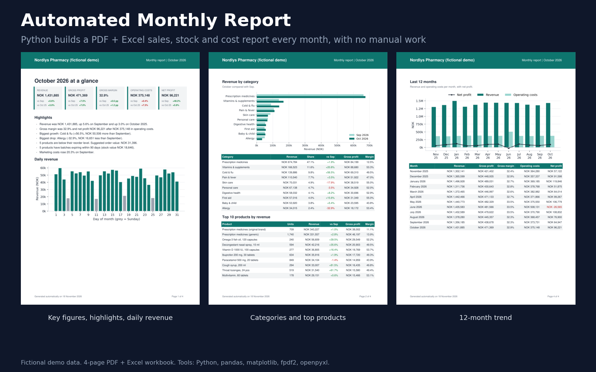

# Automated Monthly Report (Python → PDF + Excel)

Every month a small business needs the same report: sales, profit, stock and
costs. Doing it by hand in Excel takes hours. This project builds it
automatically: one command (or a scheduled task) reads the raw data and produces
a **ready-to-send PDF report** and an **Excel workbook** with all the detail,
and can **email both** to the owner.

The demo uses a **fictional pharmacy** with randomly generated data. No real
company or customer data is included.



**Sample output:** [PDF report](samples/monthly_report_2026-10.pdf) ·
[Excel workbook](samples/monthly_report_2026-10.xlsx)

## What the report contains

| Page | Content |
|---|---|
| 1. At a glance | Revenue, gross profit, gross margin, operating costs and net profit, each compared with last month and the same month last year; automatic written highlights; daily revenue chart |
| 2. Sales | Revenue by category vs last month (chart + table with share and margin); top 10 products |
| 3. Stock & costs | **Reorder list** with suggested order quantities, products **expiring within 90 days**, **overstock**, operating costs vs last month |
| 4. Trend | Last 12 months of revenue, costs and net profit |

The Excel file has one sheet per topic (Summary, Highlights, Categories,
Products, Reorder list, Expiring, Stock, Costs, 12-month trend), with formatted
numbers, ready for further analysis.

### Automatic highlights

The report writes its own summary in plain language, for example:

> - Revenue was NOK 1,431,885, up 5.6% on September and up 3.0% on October 2025.
> - Biggest growth: Cold & flu (+56.5%, NOK 50,506 more than September).
> - 5 products are below their reorder level. Suggested order value: NOK 31,396.
> - 5 products have batches expiring within 90 days (stock value NOK 18,646).

## Quick start

```bash
git clone https://github.com/eskandersnoussi/monthly-report-automation.git
cd monthly-report-automation
python -m venv venv
venv\Scripts\activate          # macOS/Linux: source venv/bin/activate
pip install -r requirements.txt
python report.py
```

The report for the last complete month is saved in `reports/<month>/`.

```bash
python report.py --month 2026-06     # a specific month
python report.py --email             # also email it (see below)
python make_data.py                  # regenerate the fictional sample data
```

## Use your own data

Put four CSV files in `data/` (or point to another folder with `--data`).
These can be exports from a POS system, ERP or accounting software.

| File | Columns |
|---|---|
| `products.csv` | sku, product, category, unit_cost, unit_price, reorder_level |
| `sales.csv` | date, sku, quantity, unit_price, revenue, cost |
| `stock.csv` | month (YYYY-MM), sku, on_hand, nearest_expiry |
| `costs.csv` | month (YYYY-MM), cost_type, amount |

The data is checked before the report is built (missing columns, negative
quantities, unknown products, missing month), with a clear error message.

## Email the report

Copy `.env.example` to `.env` and fill in your SMTP settings (works with
Microsoft 365 / Outlook, Gmail and most mail providers), then:

```bash
python report.py --email
```

## Run it automatically every month

**Windows (Task Scheduler)**, on the 1st of every month at 07:00:

```bash
schtasks /create /tn "Monthly report" /sc monthly /d 1 /st 07:00 /tr "C:\path\to\venv\Scripts\python.exe C:\path\to\report.py --email"
```

**Linux / macOS (cron):**

```
0 7 1 * * cd /path/to/monthly-report-automation && venv/bin/python report.py --email
```

## Project structure

```
├── report.py               # command line: build (and email) the report
├── make_data.py            # generates the fictional sample data
├── reportgen/
│   ├── data.py             # load + validate the CSV files
│   ├── metrics.py          # all calculations and the written highlights
│   ├── charts.py           # matplotlib charts
│   ├── pdf.py              # PDF layout (fpdf2)
│   ├── excel.py            # Excel workbook (openpyxl)
│   └── emailer.py          # send by email (SMTP)
├── data/                   # fictional sample data
├── samples/                # sample PDF and Excel output
├── demo/make_screenshots.py
└── tests/                  # automated tests
```

## Tests

```bash
pytest
```

16 tests check the calculations against hand-computed numbers, the data
validation, the PDF/Excel output, the command line and the email step.

## Tech

Python · pandas · matplotlib · fpdf2 · openpyxl · smtplib

## License

MIT – see [LICENSE](LICENSE).
